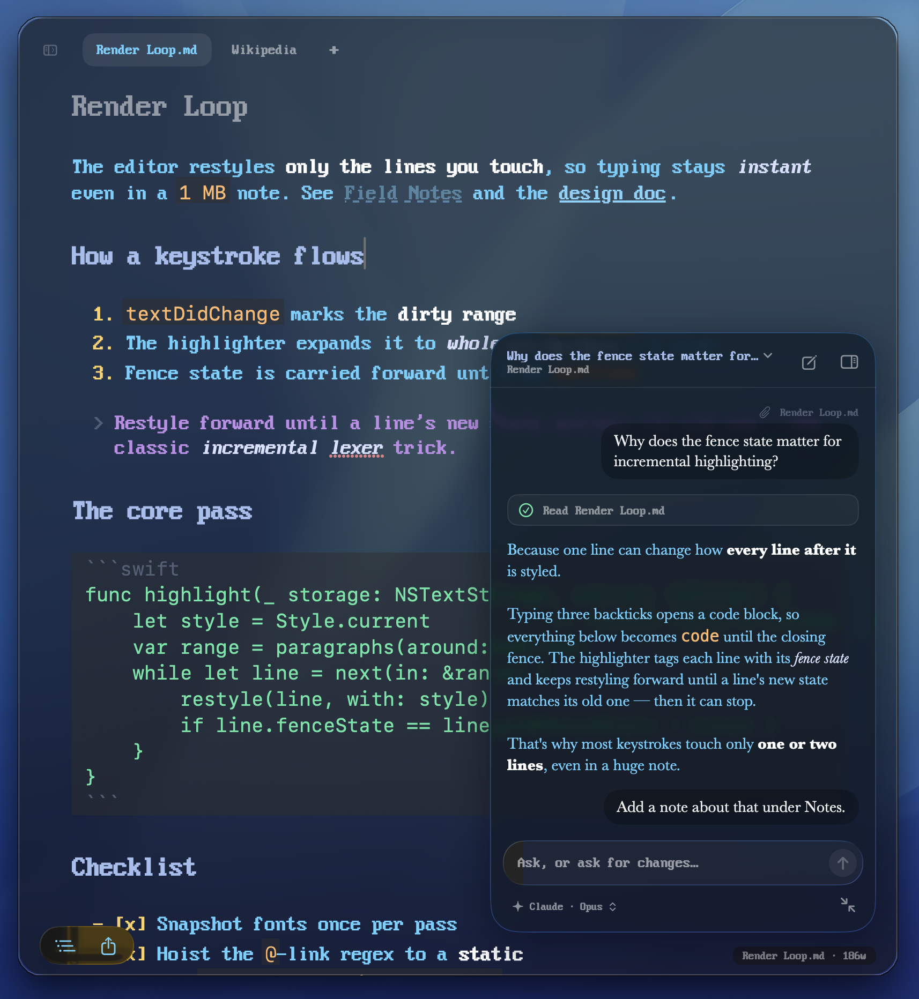
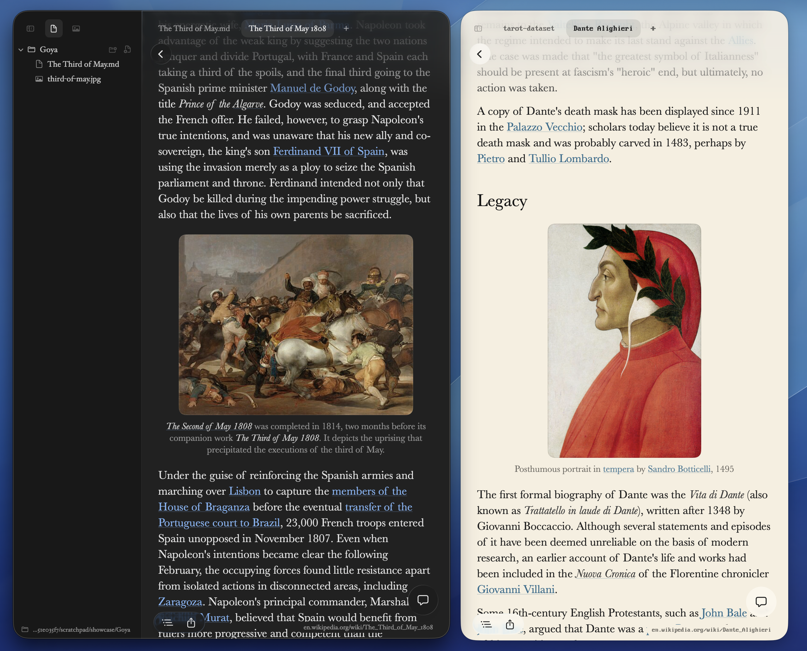
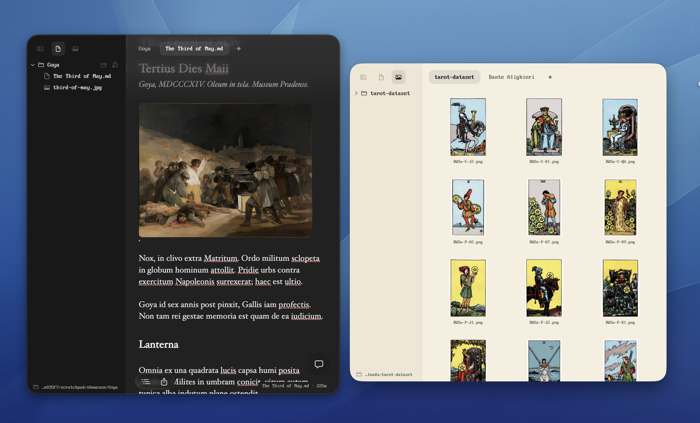
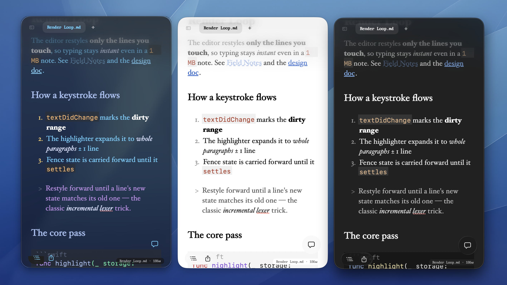

# Catalog

Catalog is your go-to tool for browsing and editing agent filesystems natively on Mac. It features a built-in agent that can modify any file and natively embed Wikipedia articles for research tasks.

### Write and edit, with an agent beside you



Notes render as you type, Obsidian-style. Markdown syntax is hidden except on
the line you're editing. Click the chat button in the lower right (or press
⌘J) to open the assistant. It can see the open page and edit files in your
folder, and notes reload in place as it works. Drag the panel to the window's
right edge to dock it as a sidebar.

### Read Wikipedia natively


Articles render natively, including infoboxes, figures, tables, and math.
They open as ordinary tabs, and the assistant can work from them and write
what it finds into your notes.



Wikipedia pages open as tabs next to your notes and images. Drag any tab out
to open it in its own window.

### Browse folders and images



The sidebar shows `~/Documents` until you open a folder. **Files** shows the
folder's file tree, and **Media** shows a gallery of every image under a
folder. Notes can embed images inline.

### Themes



Choose Plasma (translucent), Dark, Light, or Paper in Settings (⌘,).

## Install

```
make run       # build, bundle, and launch dist/Catalog.app
make install   # copy to /Applications
make test      # regression tests
```

Requires macOS 26 (Tahoe) and Xcode 26 or newer. The Makefile prefers a full
Xcode install when one is available; set `DEVELOPER_DIR` to use a different
one.

## Assistant

The assistant works in the open folder, or in `~/Documents` when no folder is
open. Choose who answers from the menu at the bottom of the panel:

- **Claude** (Opus or Sonnet), through your Claude subscription, using
  [Claude Code](https://claude.com/product/claude-code).
- **Codex**, through your ChatGPT subscription, using `codex exec`, which is
  sandboxed to the working directory.
- **Claude API**, with an Anthropic API key from Settings.
- **Apple Intelligence**, which runs on device. It answers questions but
  can't edit files.

Claude Code and Codex must be installed, and Catalog looks for them on your
login shell's PATH. If one isn't signed in, the menu offers **Sign In**, which
runs that tool's login in Terminal; Catalog never handles those credentials.
Conversations are shared across windows, and the title menu at the top of the
panel lists them.

## Links and references

With a folder open, type `@` or `[[` to reference any file. Catalog uses
standard Markdown links and Obsidian wiki links, so they also work in GitHub,
Obsidian, and other Markdown tools:

```markdown
[Design notes](../notes/Design.md#palette)  relative path, like GitHub
[[Design]]  [[Design|text]]  [[Design#Palette]]  wiki link by note name
```

Click a link to follow it. Option-click a link to put the cursor inside it
instead.

## Sessions and recovery

Notes autosave as you type. Unsaved drafts, including untitled ones, are kept
in `~/Library/Application Support/Catalog/Recovery/` and come back after a
crash or quit. Your windows, tabs, and folders are restored when you relaunch.

## Shortcuts

| Key | Action |
| --- | --- |
| ⌘B / ⌘I / ⌘E / ⌘K | bold / italic / code / link |
| ⌘1–⌘6, ⌘0 | set / clear heading |
| `/` at line start | slash commands |
| ⌘N ⌘T ⇧⌘T | new window / note / Wikipedia page |
| ⌥⌘O | open folder |
| ⌘J | show or hide the assistant |
| ⌘[ ⌘L ⌥⌘R | Wikipedia back / search / random |
| ⌘= / ⌘− | bigger / smaller text |
| ⌘F | find |

## Testing

`make test` runs the regression tests with separate preferences and recovery
storage, so they don't touch your own settings or drafts. For UI checks,
launch a separate test instance:

```
open -na /Applications/Catalog.app --args --test-mode
```

Each test launch starts with a fresh profile. See `AGENTS.md` for the
scripting flags. `make benchmark-gallery GALLERY=/path` benchmarks gallery
scrolling.
