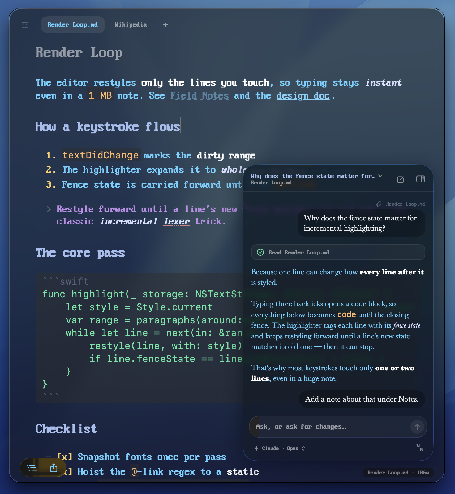
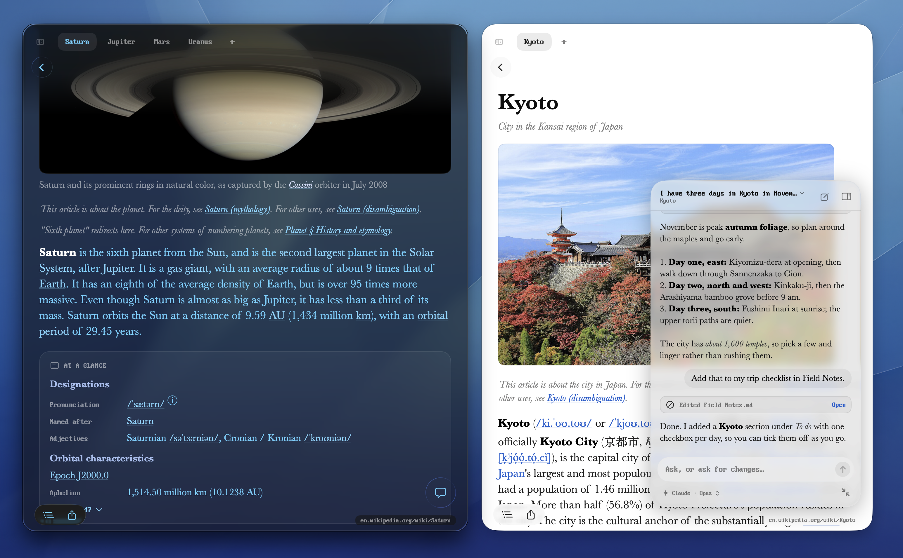
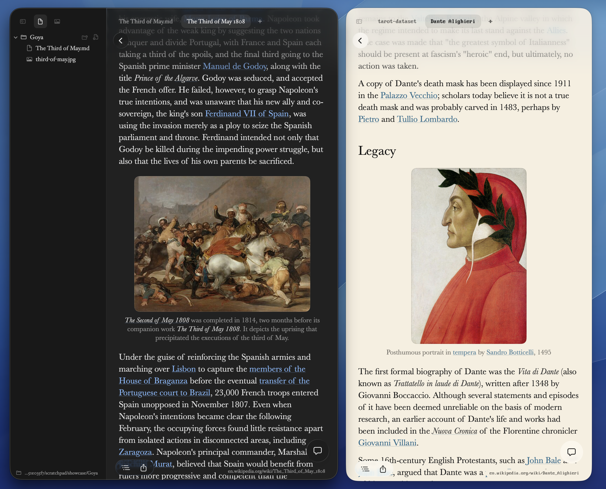
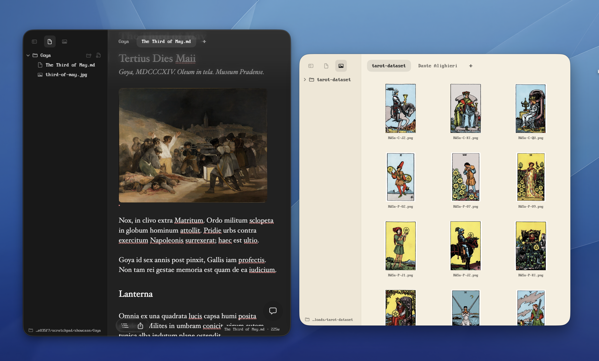
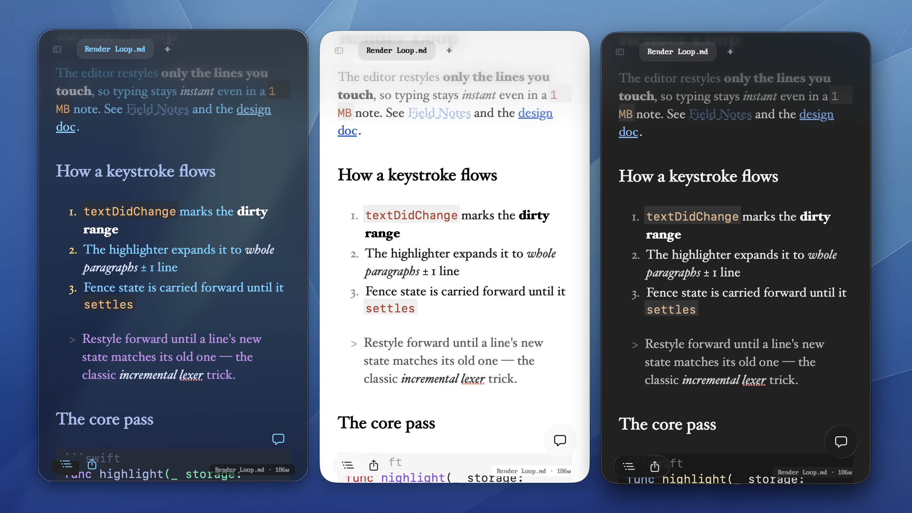

# Catalog

Catalog is your go-to tool for browsing and editing agent filesystems natively on Mac. It features a built-in agent that can modify any file and natively embed Wikipedia articles for research tasks.

### Write and edit, with an agent beside you



Notes render as you type, Obsidian-style. Markdown syntax is hidden except on
the line you're editing. Click the chat button in the lower right (or press
⌘J) to open the assistant. It can see the open page and edit files in your
folder, and notes reload in place as it works. Drag the panel to the window's
right edge to dock it as a sidebar.

### Read Wikipedia natively



Articles render natively, including infoboxes, figures, tables, and math.
They open as ordinary tabs, and the assistant can work from them and write
what it finds into your notes. Click a link to follow it in the same tab,
⌘-click to open it in a new tab in the background, or ⌘⇧-click to open it in
a new tab and switch to it. Article links in the assistant's replies work the
same way.

To jump to another article, click the search button at the upper right of an
article (or press ⌘L): it opens into a search field, with suggestions as you
type. Return opens the article in place, ⌘Return in a background tab, and
⌘⇧Return in a new tab. Escape or a click elsewhere closes it.



### Browse folders and images



The sidebar shows `~/Documents` until you open a folder. **Files** shows the
folder's file tree, and **Media** shows a gallery of every image under a
folder. Notes can embed images inline.

### Themes



Choose Plasma, Dark, Dark Glass, Light, Light Glass, or Paper in Settings (⌘,).
Plasma and the Glass themes are translucent.

## Install

```
make run       # build, bundle, and launch dist/Catalog.app
make install   # copy to /Applications
make test      # regression tests
```

Requires macOS 26 (Tahoe) and Xcode 26 or newer. The Makefile prefers a full
Xcode install when one is available; set `DEVELOPER_DIR` to use a different
one.

## Assistant

The assistant works in the open folder, or in `~/Documents` when no folder is
open. Choose who answers from the menu at the bottom of the panel:

- **Claude** (Opus or Sonnet), through your Claude subscription, using
  [Claude Code](https://claude.com/product/claude-code).
- **Codex**, through your ChatGPT subscription, using `codex exec`, which is
  sandboxed to the working directory.
- **Claude API**, with an Anthropic API key from Settings.
- **Apple Intelligence**, which runs on device. It answers questions but
  can't edit files.

Claude Code and Codex must be installed, and Catalog looks for them on your
login shell's PATH. If one isn't signed in, the menu offers **Sign In**, which
runs that tool's login in Terminal; Catalog never handles those credentials.
Conversations are shared across windows, and the title menu at the top of the
panel lists them.

## Links and references

With a folder open, type `@` or `[[` to reference any file. Catalog uses
standard Markdown links and Obsidian wiki links, so they also work in GitHub,
Obsidian, and other Markdown tools:

```markdown
[Design notes](../notes/Design.md#palette)  relative path, like GitHub
[[Design]]  [[Design|text]]  [[Design#Palette]]  wiki link by note name
```

Click a link to follow it. Option-click a link to put the cursor inside it
instead.

## Embedded quotes

An embedded quote holds a passage from another note, a Wikipedia section, or
an image, in full, with a link back to where it came from. It's an ordinary
blockquote whose last line is the attribution, so it reads the same anywhere:

```markdown
> Watch the light, not the birds.
>
> Patience is most of the method.
> — [Field Guide § Second Section](Field%20Guide.md#second-section)

> Kyoto served as Japan's capital from 794 until 1868.
> — [Kyoto § History](encyclopedia://wiki/Kyoto#History)

> 
> — [Coastline at dusk](Media/coastline.png)
```

The last line starts with an em dash (`--` also works) and links to a note
(a relative path and a heading slug, as above), a Wikipedia article
(`encyclopedia://wiki/Title#Section_anchor`), or a media file. A Wikipedia
figure quotes as its image (``), its
caption, and the section's link. A blockquote without that last line is just
a blockquote.

Catalog shows each one as a card with the source beneath it. Click the source
(or ⌘-click anywhere on the card) to open it: the note at that heading with the
passage highlighted, the article at that section, or the image or video. With
the cursor inside, the Markdown shows, dimmed, so you can edit it.

To make one, choose **Copy as Embedded Quote** (⇧⌘C) and paste it into a note:

- **In a note**, select text, then use the selection toolbar's quote button,
  the context menu, or ⇧⌘C. The quote is attributed to the nearest heading
  above it. Pasted into another note, its link is rewritten relative to that
  note; pasted into another app, it carries an absolute path.
- **In a Wikipedia article**, right-click a paragraph or list to quote it, or a
  heading to quote its whole section. ⇧⌘C quotes the selected text; with
  nothing selected it quotes the section you're reading (the menu says
  **Copy Section as Embedded Quote**). Right-click a figure to quote it.
- **For images and videos**, right-click an image in a note, an image tab, the
  file tree, or the icon browser, or press ⇧⌘C in an image tab. The caption
  starts as the file name; edit the link text to change it.

The assistant knows the format too: ask it to "quote the History section of
this article into my notes" or "pull the second section of Field Guide into
this note." With the Claude API it fetches sections with a
`quote_wikipedia_section` tool.

Images have their own right-click menu everywhere they appear: **Copy Image**
(the full picture, which pastes into other apps), **Copy as Embedded Quote**,
and **Reveal in Finder** or, for Wikipedia images, **Copy Image Address** and
**Open Image in Browser**. Wikipedia captions are selectable.

## Sessions and recovery

Notes autosave as you type. Unsaved drafts, including untitled ones, are kept
in `~/Library/Application Support/Catalog/Recovery/` and come back after a
crash or quit. Your windows, tabs, and folders are restored when you relaunch.

## Shortcuts

| Key | Action |
| --- | --- |
| ⌘B / ⌘I / ⌘E / ⌘K | bold / italic / code / link |
| ⇧⌘C | copy as embedded quote |
| ⌘1–⌘6, ⌘0 | set / clear heading |
| `/` at line start | slash commands |
| ⌘N ⌘T ⇧⌘T | new window / note / Wikipedia page |
| ⌥⌘O | open folder |
| ⌘J | show or hide the assistant |
| ⌘[ ⌘L ⌥⌘R | Wikipedia back / search / random |
| ⌘Return / ⌘⇧Return in article search | open in a background / new tab |
| ⌘-click / ⌘⇧-click link | Wikipedia link in a background / new tab |
| ⌘= / ⌘− | bigger / smaller text |
| ⌘F | find |

## Testing

`make test` runs the regression tests with separate preferences and recovery
storage, so they don't touch your own settings or drafts. For UI checks,
launch a separate test instance:

```
open -na /Applications/Catalog.app --args --test-mode
```

Each test launch starts with a fresh profile. See `AGENTS.md` for the
scripting flags. `make benchmark-gallery GALLERY=/path` benchmarks gallery
scrolling.
